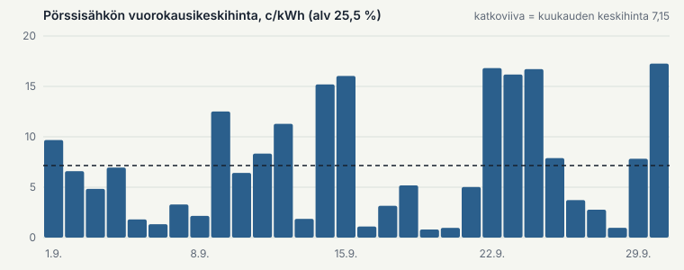
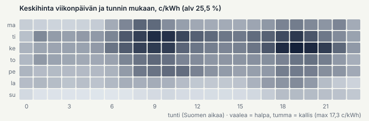
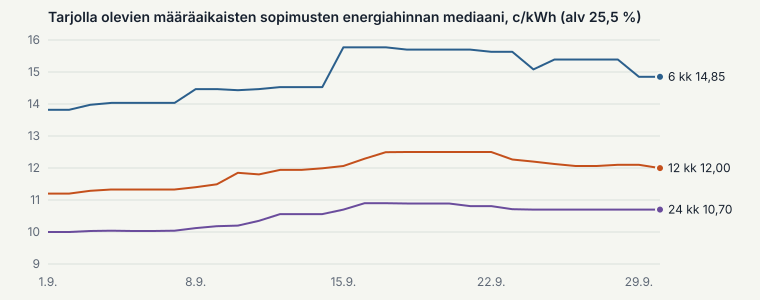

# Sähkömarkkinakatsaus: syyskuu 2026

*Prototyyppi, ei julkaistava. Oletettu julkaisupäivä 7.10.2026. Luvut: `metrics-2026-09.json`.
Kohdat ⟦AVOIN⟧ odottavat taustadataa (Fingrid, naapurialueet, sää, siirtokeskeytykset), jonka
lataus tuotantoon alkoi 1.11.2026.*

## Tärkeimmät luvut

| | Syyskuu 2026 |
|---|---|
| Pörssisähkön keskihinta | **7,15 c/kWh** (alv 25,5 %) eli 57,0 €/MWh ilman veroa |
| Muutos elokuusta / syyskuusta 2025 | +38 % / +36 % |
| Arkipäivien ja viikonloppujen keskihinta | 8,64 c/kWh ja 3,06 c/kWh |
| Sähkölämmitteisen pientalon kulutuksella painotettu hinta | ⟦AVOIN: Datahub-profiili BE02⟧ |
| 12 kk määräaikaisen sopimuksen energiahinta (mediaani) | 11,20 → **12,00 c/kWh** kuun aikana (+7 %) |
| Kvartaalisähkön energiahinta (mediaani) 1.10. alkaen | 8,92 → **13,15 c/kWh** (+47 %) |
| Lokakuun futuuri 6.10.2026 | 8,60 c/kWh (alv 25,5 %), EEX |

## Syyskuu lyhyesti

Pörssisähkön keskihinta nousi syyskuussa 7,15 senttiin kilowattitunnilta, mutta puolet tunneista
maksoi alle 4,52 senttiä. Kuusi kallista arkipäivää nosti keskiarvoa, ja viikonloppuisin sähkö
maksoi keskimäärin vain kolmanneksen arkipäivien hinnasta. Kiinteähintaiset sopimukset kallistuivat
kuun aikana noin 7 %, kun ensi talven ja vuoden 2027 sähkön hintaodotukset nousivat.
⟦AVOIN: yksi lause hinnan syistä – tuuli, lämpötila, ydinvoima ja tuonti.⟧

## Pörssisähkö syyskuussa

⟦AVOIN: kaksi paneelia samalla aika-akselilla hinnan alle – tuulivoiman tuotanto (GWh/vrk) ja
lämpötila normaaliin verrattuna. Ei kahta y-akselia samassa kuvassa.⟧

- Halvin päivä oli lauantai 19.9. (0,80 c/kWh) ja kallein keskiviikko 30.9. (17,26 c/kWh).
  Kaikki kuusi yli 15 sentin päivää olivat arkipäiviä: 14.–15.9., 22.–24.9. ja 30.9.
- Kallein tunti oli tiistaina 22.9. kello 19–20: 38,60 c/kWh. Kallein vartti oli tiistaina 15.9.
  kello 1.00–1.15: 50,16 c/kWh. ⟦TARKISTA: yöllinen vartti on poikkeuksellinen.⟧
- Hinta oli negatiivinen 6 tuntia (syyskuussa 2025: 19 tuntia). Alle 1 sentin tunteja oli 119
  eli 17 % kuukauden tunneista, ja yli 20 sentin tunteja oli 56.
- Päivän kalleimman ja halvimman tunnin ero oli keskimäärin 11,82 c/kWh.
- Päivällä (klo 7–22) sähkö maksoi keskimäärin 8,52 c/kWh ja yöllä 4,87 c/kWh.

Syyskuussa sähkö oli halvinta viikonloppuisin ja öisin. Kalleimpia olivat tiistai- ja
keskiviikkoaamut kello 8–11 sekä keskiviikkoillat kello 18–22. Halvinta sähkö oli sunnuntaiaamuisin kello 2–8.

## Miksi hinta liikkui

| Tekijä | Syyskuu 2026 | Vaikutus hintaan |
|---|---|---|
| Tuulivoima | ⟦AVOIN: tuotanto TWh, käyttöaste, muutos vuodentakaisesta (Fingrid 75, 268)⟧ | |
| Lämpötila | ⟦AVOIN: poikkeama 1991–2020 normaalista, lämmitystarveluku (ERA5)⟧ | |
| Ydinvoima | ⟦AVOIN: käytettävyys %, huoltopäivät (Fingrid 188, ENTSO-E)⟧ | |
| Tuonti ja naapurialueet | ⟦AVOIN: nettotuonti TWh, osuus tunneista FI = SE1 ja FI = EE, hintaero SE1/SE3⟧ | |
| Pohjoismainen vesitilanne | ⟦AVOIN: Norjan altaat mediaaniin verrattuna kuun lopussa (NVE)⟧ | |
| Kaasu ja päästöoikeudet | ⟦AVOIN: kaasuvarastojen täyttöaste EU ja Saksa (GIE AGSI)⟧ | |
| Kulutus | ⟦AVOIN: kulutus TWh ja huippu MW (Fingrid 124)⟧ | |

## Mitä kotitaloudet maksoivat

⟦AVOIN: kulutuksella painotettu pörssisähkön hinta asuntotyypeittäin (kerrostalo,
sähkölämmitteinen pientalo, muu pientalo; Fingridin Datahub-profiilit). Merkintä "alustava".⟧

⟦AVOIN: pörssisähkösopimus (mediaanimarginaali 0,50 c/kWh ja perusmaksu) verrattuna 12 kk
määräaikaiseen sopimukseen 2 000, 5 000 ja 18 000 kWh:n vuosikulutuksella. Yksi kuukausi ei
yksin ratkaise vertailua, koska kiinteä hinta kattaa myös talven; päävertailu on vuoden alusta
kertynyt hinta.⟧

## Sopimusmarkkina

- Määräaikaisten sopimusten energiahinnat nousivat syyskuussa: 6 kk 13,82 → 14,85 c/kWh, 12 kk
  11,20 → 12,00 c/kWh ja 24 kk 10,00 → 10,70 c/kWh (mediaanit, alv 25,5 %).
- Lyhin sopimus on nyt kallein, koska syksyllä tehty 6 kuukauden sopimus kattaa koko talven.
- Samaan aikaan vuoden 2027 ensimmäisen neljänneksen futuuri nousi 14 % ja koko vuoden 2027
  futuuri 12 % (EEX, 31.8.–30.9.2026).
- Toistaiseksi voimassa olevien kiinteähintaisten sopimusten mediaani nousi 12,41 → 13,55 c/kWh.
  Voltikan hintaindeksi, joka seuraa myyjien itse asettamia energiahintoja, nousi 11,29 → 11,84
  c/kWh (+4,9 %).
- Kvartaalisähkön hinnat vaihtuivat 1.10.: mediaani nousi 8,92 sentistä 13,15 senttiin
  kilowattitunnilta (+47 %), koska loka–joulukuu on kalliimpi kuin heinä–syyskuu.
- Pörssisähkösopimusten marginaalin mediaani pysyi 0,50 c/kWh:ssa. Perusmaksun mediaani nousi
  4,20 eurosta 4,52 euroon kuukaudessa.
- Kotitalouksille oli tarjolla 293 sopimusta 1.9. ja 278 sopimusta 30.9. Kuun aikana tuli 37
  uutta sopimusta ja 37 poistui (ilman samoja sopimuksia uudella tunnisteella).

## Näkymät

**Miten viime kuun odotus toteutui.** Elokuun viimeisenä kaupankäyntipäivänä syyskuun futuuri oli
9,83 c/kWh (alv 25,5 %; EEX 31.8.2026). Toteutunut keskihinta oli 7,15 c/kWh eli 27 % odotettua
halvempi.

**Futuurit 6.10.2026 (EEX, alv 25,5 %):**
- lokakuu 8,60 c/kWh (31.8.: 11,47 c/kWh, eli odotus laski kuukaudessa 25 %)
- marraskuu 9,59 c/kWh
- tammi–maaliskuu 2027 12,85 c/kWh
- vuosi 2027 7,56 c/kWh

**Sää.** ⟦AVOIN: ECMWF:n 46 vuorokauden ennuste todennäköisyytenä (lämpimämpi vai kylmempi kuin
normaali). Ennusteiden vuosikerrat tallentuvat vasta 1.11.2026 alkaen, joten syyskuun
prototyypissä tätä ei voi näyttää.⟧

**Tiedossa olevat tapahtumat lokakuussa:**
- 1.10. kvartaalisähkön uudet hinnat (ks. yllä)
- 25.10. kesäaika päättyy
- 31.10. pyhäinpäivä
- ⟦AVOIN: ydinvoimaloiden ja siirtoyhteyksien suunnitellut huollot (ENTSO-E-keskeytykset)⟧

**Riskit.** Futuurit kertovat markkinan keskimääräisen odotuksen. Kylmä ja tyyni jakso, ydinvoimalan
vika tai tuontiyhteyden rajoitus voi nostaa yksittäisten päivien hinnat selvästi korkeammalle.
Talvella 2026 futuurit aliarvioivat tällaisten jaksojen vaikutuksen. ⟦TARKISTA: lähde ja luku
tutkimusraporteista.⟧

## Menetelmä ja lähteet

- **Pörssisähkö:** ENTSO-E Transparency Platform, Suomen vuorokausimarkkinan hinnat. Keskihinta on
  kuukauden tuntihintojen aritmeettinen keskiarvo Suomen aikaa. Arvonlisävero 25,5 %.
- **Sopimukset:** Voltikan päivittäin keräämät kotitaloussopimusten hinnat. Luvut ovat tarjolla
  olevien sopimusten mediaaneja, eivät asiakkaiden maksamia hintoja.
- **Futuurit:** EEX, Finnish Power Base -futuurien päätöskurssit. Muunnettu senteiksi
  kilowattitunnilta ja lisätty arvonlisävero 25,5 %.
- ⟦AVOIN: Fingrid (CC BY 4.0), Open-Meteo ("Weather data by Open-Meteo.com"), GIE AGSI, NVE.⟧
- Tämä katsaus kattaa vain sähköenergian hinnan. Siirtomaksut ja sähkövero eivät ole mukana.
- Luvut on jäädytetty julkaisuhetkellä. Mahdolliset korjaukset merkitään tähän.
