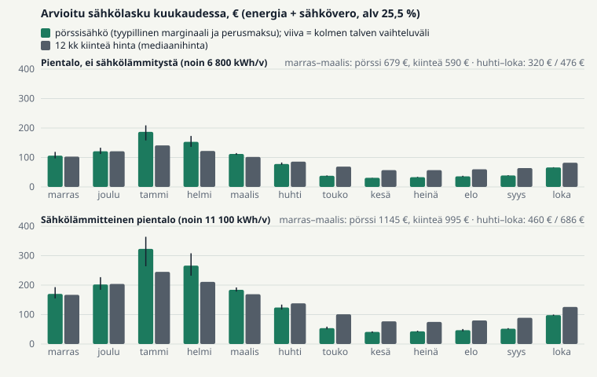
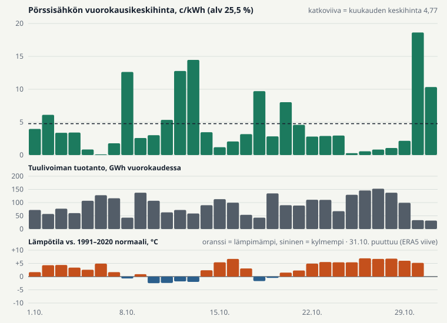
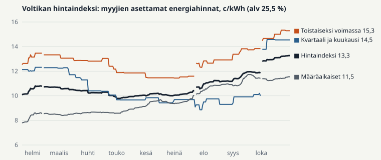

# Sähkömarkkinakatsaus: lokakuu 2026 ja näkymät talveen

*Julkaistu 6.11.2026: voltikka.fi/markkinakatsaus/2026-10 (sivun teksti: `laravel/resources/views/market-reviews/2026-10.blade.php`). Video: youtube.com/watch?v=i7ZopmWpqco. Luvut: `consumer-results-2026-11.json`,
`consumer-outlook-2026-11.json`, `metrics-2026-10.json`, `drivers-2026-10.json`. ⟦TARKISTA⟧ =
tarkista ennen julkaisua.*

Lokakuu oli lämmin ja tuulinen, ja pörssisähkö maksoi keskimäärin vain 4,77 c/kWh. Halpa sähkö
loppuu marraskuussa: tammikuun futuuri on 15,7 c/kWh (EEX 30.10.2026, alv 25,5 %).

## Miltä tuleva talvi nyt näyttää

Talvesta tulee kallis. Odotamme marras–maaliskuun pörssisähkön maksavan 11–16 c/kWh, kun
huhti–lokakuun odotus on 4–10 c/kWh. Syitä on kolme: Norjan vesialtaat ovat 13 prosenttiyksikköä
tavallista vajaammat, Euroopan kaasuvarastot ovat vajaammat kuin vuosi sitten, ja Olkiluoto 3
palaa vuosihuollosta vasta 11.11.

Marraskuu näytti jo, mitä tämä tarkoittaa. Maanantaina 2.11. tuulivoimaa oli vain kolmannes
lokakuun keskitasosta, ja pörssisähkö maksoi keskimäärin 26 c/kWh ja illalla 51 c/kWh. Pahin riski
on kylmä ja tyyni viikko, kuten tammikuussa 2024. Silloin pörssisähkö maksaa viikon ajan noin
34 c/kWh. Lämmin syksy painoi hinnat syys- ja lokakuussa selvästi futuurien alle, mutta
sen varaan ei kannata laskea talvea.

### Sähkölämmitteinen pientalo (noin 11 100 kWh vuodessa)

**Neuvomme: pörssisähkö on pitkällä aikavälillä halvempi, mutta tuleva talvi on sille riski.**
Marras–maaliskuussa pörssisähkö maksaa noin 150 € enemmän kuin kiinteä hinta, ja kylmänä talvena
noin 190 € enemmän. Kiinteä hinta antaa varmuuden talven laskusta, mutta siitä maksat kesällä:
huhti–lokakuussa kiinteä hinta on noin 225 € kalliimpi. Koko vuonna pörssisähkö on noin 75 €
halvempi.

| Energia + sähkövero | Pörssisähkö | Kiinteä 12 kk |
|---|---|---|
| Marras–maaliskuu | 1 145 € | 995 € |
| Huhti–lokakuu | 460 € | 686 € |
| Tammikuu (kylmänä talvena) | 323 € (364 €) | 245 € (261 €) |

- **Jos haluat kiinteän hinnan, valitse 24 kuukautta.** Se kattaa kaksi talvea, ja sen hinta on
  alempi kuin 12 kuukauden sopimuksen (mediaanit 10,90 ja 12,00 c/kWh). Edullisin on
  Pohjois-Karjalan Sähkö Optimi takuu 24 kuukautta, joka on aikasähkö: ensimmäinen vuosi maksaa noin 1 500 €
  sähköveroineen, kun edullisin pörssisähkö, Herrfors Spot+, maksaa 1 564 €. Toisena vuonna
  pörssisähkö on noin 175 € halvempi, joten koko 24 kuukauden aikana se on noin 115 € edullisempi.
  36 kuukauden sopimus maksaa kolmessa vuodessa noin 290 € enemmän kuin pörssisähkö.
- **Jos siirrät kulutusta** (lämminvesivaraaja tai sähköauton lataus halvoille tunneille, noin
  900 kWh vuodessa), säästät pörssisähköllä vielä noin 77 € vuodessa.
- **Jos sinulla on kvartaalisähkö,** hintasi nousee 1.1. noin 3,8 c/kWh, ja tammi–maaliskuu maksaa
  noin 155 € enemmän kuin nyt. Vaihda ennen vuodenvaihdetta pörssisähköön tai 24 kuukauden
  kiinteään hintaan.

### Pientalo ilman sähkölämmitystä (noin 6 800 kWh vuodessa)

**Neuvomme: pysy pörssisähkössä.** Talvella se maksaa noin 90 € enemmän kuin kiinteä hinta, mutta
huhti–lokakuussa noin 155 € vähemmän, joten vuodessa se on noin 65 € halvempi. Edullisin 24 kuukauden
kiinteä hinta on ensimmäisenä vuonna lähes yhtä halpa, mutta toisena vuonna noin 120 €
pörssisähköä kalliimpi. Kvartaalisähkön asiakkaalle tammi–maaliskuu maksaa noin 90 € enemmän kuin
nyt; vaihda pörssisähköön ennen vuodenvaihdetta.

### Kerrostaloasunto (noin 2 100 kWh vuodessa)

**Neuvomme: pysy pörssisähkössä.** Se on vuoden aikana noin 40 € kiinteää halvempi, ja kalleinkin
talviviikko maksaa vain noin 30 €. Edullisin on Nordic Green Energy Pörssisähkö.

Omalla kulutuksellasi voit laskea sopimusten hinnat osoitteessa voltikka.fi/sahkosopimus. Laskelman
perusteet ovat sivun lopussa.

---

## Tarkemmat tiedot: lokakuu 2026

### Tärkeimmät luvut

| | |
|---|---|
| Pörssisähkön keskihinta lokakuussa | **4,77 c/kWh** (alv 25,5 %), −33 % syyskuusta, −22 % vuodentakaisesta |
| Kulutuksella painotettu hinta lokakuussa (alustava) | kerrostaloasunto 5,08 c/kWh (syyskuussa 7,46), sähkölämmitteinen pientalo 4,81 c/kWh (syyskuussa 7,11); molemmat −32 %. Kerrostalon kulutus painottuu kalliisiin iltatunteihin |
| Sähkölämmitteisen pientalon lokakuun energialasku | pörssisähköllä 71 €, määräaikaisella 121 € (mediaanisopimukset, sähkövero mukana) |
| Voltikan hintaindeksi (myyjien asettamat energiahinnat) | 13,27 c/kWh, +12,0 % lokakuussa (30.9.–31.10.) ja +17,5 % syyskuun alusta |
| 12 kuukauden kiinteän hinnan mediaani 2.11. | 12,00 c/kWh, ennallaan lokakuussa |
| Tuleva talvi, sähkölämmitteinen pientalo | kiinteä hinta noin 150 € pörssisähköä halvempi marras–maaliskuussa; koko vuonna pörssisähkö noin 75 € halvempi |

### Mikä vaikutti sähkön hintaan

| Tekijä | Vaikutus | Selitys |
|---|---|---|
| Tuulivoima | laski | Tuotanto oli 2,83 TWh, 23 % enemmän kuin vuotta aiemmin (kapasiteetti 9 553 MW). |
| Lämpötila | laski | Lokakuu oli 2,9 astetta normaalia (1991–2020) lämpimämpi, ja lämmitystarve oli 75 % normaalista. |
| Ydinvoima | nosti | Käytettävyys oli 46,5 %: Olkiluoto 3 oli vuosihuollossa koko kuun, Loviisa 1 ja 2 osan kuusta. |
| Tuonti ja vienti | vähäinen | Nettotuonti oli pieni (0,39 TWh). Suomen hinta (ilman veroa 3,80 c/kWh) oli Pohjois-Ruotsin SE1:n (2,72) ja Etelä-Ruotsin SE3:n (7,35) välissä ja alempi kuin Virossa (8,21). Suomi vei sähköä Viroon 0,64 TWh. |

Lämmin ja tuulinen sää painoi hinnan alas, vaikka lähes puolet ydinvoimasta oli huollossa.
Kuun kallein päivä oli 30.10. (18,6 c/kWh), kun tuuli heikkeni ja Olkiluoto 1 oli vuorokauden
pois verkosta.

### Sopimusmarkkina

**Myyjät nostivat energiahintojaan, vaikka pörssisähkö halpeni lokakuussa kolmanneksen.**
Voltikan hintaindeksi seuraa myyjien itse asettamia energiahintoja. Suurin osa lokakuun noususta
tuli kuun vaihteessa, kun kvartaali- ja kuukausihintaisten sopimusten uudet hinnat alkoivat 1.10.
Indeksi on nyt 36 % korkeampi kuin toukokuun pohjalla (9,78 c/kWh). Myyjät hinnoittelevat tulevaa talvea, eivät mennyttä
kuukautta: tammi–maaliskuun futuuri nousi lokakuussa 6 % ja vuoden 2027 futuuri 9 %.

- Eniten nousivat kvartaali- ja kuukausihintaiset sopimukset (+45,4 %, 14,54 c/kWh) ja
  toistaiseksi voimassa olevat sopimukset (+10,5 %, 15,29 c/kWh). Määräaikaiset nousivat vähiten (+1,2 %, 11,55 c/kWh),
  koska niiden hinnat nousivat jo syyskuussa.
- 24 kuukauden sopimusten mediaani nousi 10,70 sentistä 10,90 senttiin, ja 6 kuukauden mediaani on
  14,90 c/kWh. Pitkät sopimukset ovat lyhyitä halvempia: syksyllä tehty 6 kuukauden sopimus kattaa
  lähes pelkkää talvea, ja 24 kuukauden sopimuksen hinnassa on mukana vuosi 2028, jonka futuuri
  (7,14 c/kWh) on alempi kuin vuoden 2027 futuuri.

### Ennusteet

**Pörssisähkö.** Futuurit 30.10.2026 (EEX, alv 25,5 %): marraskuu 11,33 c/kWh, tammi–maaliskuu
14,54 c/kWh ja vuosi 2027 8,41 c/kWh. Lokakuulle futuuri odotti 30.9. hintaa 10,29 c/kWh, ja
toteutunut hinta oli 54 % halvempi; syyskuussa ero oli 27 %. Marraskuun kuusi ensimmäistä päivää
maksoivat keskimäärin 8,8 c/kWh, ja kaksi ensimmäistä viikkoa ovat normaalia lämpimämpiä (ECMWF 1.11.,
todennäköisyys 92–100 %), joten marraskuu jää futuuria halvemmaksi.

**Sopimushinnat.** Määräaikaisten sopimusten hinnat pysyvät ennallaan joulukuun alkuun (Voltikan
ennuste). Kvartaalisähkön mediaanihinta nousee 1.1. 13,12 sentistä noin 16,9 senttiin
kilowattitunnilta, koska tammi–maaliskuun futuuri on selvästi korkeampi kuin loka–joulukuun
futuuri oli syyskuun lopussa.

**Tapahtumat.** Olkiluoto 3 palaa 11.11. Olkiluoto 2:n teho on rajoitettu huhtikuuhun 2027.
Fenno-Skan 2 -yhteys Ruotsiin on rajoitettu 2.–7.11. Kvartaalisopimukset saavat uudet
hinnat 1.1.2027.

---

## Näin laskimme

**Kotien sähkölaskut**
- **Mitä lasku sisältää:** sähköenergian ja sähköveron (2,918 c/kWh alv mukaan lukien).
  Siirtomaksut eivät ole mukana.
- **Kodit:** Fingridin Datahub kertoo, kuinka paljon keskimääräinen kerrostaloasunto, pientalo ilman
  sähkölämmitystä ja sähkölämmitteinen pientalo kuluttavat sähköä kunakin tuntina. Vuodessa se on
  noin 2 100, 6 800 ja 11 100 kWh. Jos kulutat enemmän, eurot kasvavat samassa suhteessa.
- **Tulevat hinnat:** kunkin kuukauden hintataso on Suomen sähköfutuuri 30.10.2026. Tuntien
  vaihtelu tulee kolmesta menneestä talvesta (2023–24, 2024–25 ja 2025–26): jokainen tuleva tunti
  saa saman päivän ja kellonajan hinnan ja kulutuksen menneeltä talvelta, siirrettynä futuurin
  tasolle. Näin kylmä tunti on sekä kallis että kulutukseltaan suuri, kuten todellisuudessakin.
  Luvut ovat kolmen talven keskiarvo; kylmä talvi tarkoittaa talven 2023–24 säätä.
- **Tyypillinen sopimus:** pörssisähkö, jonka marginaali on 0,50 c/kWh ja perusmaksu 4,12 €/kk
  (tarjolla olevien sopimusten mediaanit 2.11.), ja 12 kuukauden kiinteä hinta 12,00 c/kWh ja
  4,89 €/kk (mediaanit).
- **Edullisimmat sopimukset:** hinnoittelimme kaikki 2.11. koko maassa tarjolla olleet
  kotitaloussopimukset samalla laskentamoottorilla kuin Voltikan laskuvertailun, normaalihinnoilla
  ilman kampanjaetuja. Kulutusvaikutteisia sopimuksia ei voi asettaa järjestykseen, koska myyjä ei
  kerro vaikutuksen suuruutta.
- **Toinen ja kolmas vuosi:** futuurit kvartaaleittain syyskuuhun 2028 sekä vuosifutuurit 2028 ja
  2029. Kulutus ja tuntien vaihtelu ovat samat kuin ensimmäisenä vuonna, ja kiinteä hinta pysyy
  samana koko sopimuskauden.
- **Kvartaalisähkö 1.1.:** uusi hinta on nykyinen hinta, johon lisätään tammi–maaliskuun futuurin
  ero siihen loka–joulukuun futuuriin, jolla nykyinen hinta asetettiin.
- **Kulutuksen siirto:** joka päivä 1 kWh siirtyy kustakin neljästä kalleimmasta tunnista neljään
  halvimpaan tuntiin.

**Voltikan hintaindeksi** on koko maassa tarjolla olevien kiinteiden, toistaiseksi voimassa
olevien sekä kvartaali- ja kuukausihintaisten sopimusten energiahintojen painotettu keskiarvo. Kukin myyjän sopimusryhmä on
mukana yhdellä hinnalla, ja ryhmien painot ovat kiinteät. Pörssisähkö ei ole mukana.

**Lähteet**

- **Pörssisähkö:** ENTSO-E Transparency Platform. Kuukauden tuntihintojen keskiarvo Suomen aikaa,
  alv 25,5 % kaikkiin tunteihin.
- **Kulutus:** Fingrid Datahub (aineisto 364) ja Fingridin avoin data (CC BY 4.0). Lokakuun
  Datahub-luvut ovat alustavia noin 11.11. asti.
- **Sää:** Weather data by Open-Meteo.com (ERA5, ECMWF). **Vesi ja kaasu:** NVE, GIE AGSI.
- **Sopimukset:** Voltikan päivittäin keräämät kotitaloussopimusten hinnat (tarjolla olevien
  sopimusten mediaanit).
- **Futuurit:** EEX, Finnish Power Base -päätöskurssit, muunnettu senteiksi kilowattitunnilta ja
  lisätty alv 25,5 %.
- **Sähkövero:** veroluokka I 2,325 c/kWh ilman arvonlisäveroa (Verohallinto, 1.4.–31.12.2026).
  Vuodelle 2027 oletetaan sama vero.
- Luvut on jäädytetty julkaisuhetkellä. Korjaukset merkitään tähän.
