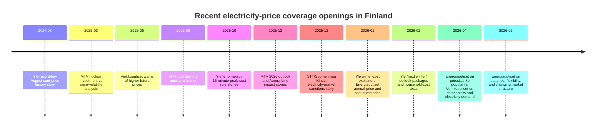

# Finland electricity prices media target list using Voltikka.fi data

## Executive summary

The most promising people to pitch are the reporters and editors who already treat electricity prices as a *data story* rather than only a weather or household-cost story. On the evidence I found, the strongest first-wave targets are **Petri Sallinen** at *Energiauutiset*, **Pekka Pantsu** and **Minna Pantzar** at *Yle*, **Petri Vironen** at *Yle*, **Ossi Rajala**, **Mikko Kormilainen**, and **Satu Koistinen** at *MTV Uutiset*, plus **Antti Korhonen**, **Petri Lajunen**, and **Akseli Lehtonen** at *Verkkouutiset*. These writers either publish recurring electricity-price explainers, use time-series or cost-comparison data, or explicitly translate wholesale/retail market mechanics into consumer implications. citeturn37view0turn39search0turn39search7turn40view0turn41search4turn41search7turn18view2turn23search4turn24search9turn15view1turn30search2turn30search3

Voltikka is genuinely pitchable because it fills a gap between *official market data* and *consumer contract reality*. Its public pages show daily retail contract-price history across hundreds of contracts, a 30-day fixed-price forecast model for 6/12/24-month contracts, and spot-price history plus third-party day-ahead predictions, with CSV export and a CC BY 4.0 citation path. That gives you media hooks that Nord Pool, Fingrid, Energiavirasto, and Energy-Charts do not package in the same consumer-facing way: *retailer contract moves, lock-now vs wait signals, markup behavior, and historical retail pricing by contract type*. citeturn33view0turn34view0turn34view2turn6search21turn40view0

The best outreach order is not “largest outlet first.” It is *highest-relevance and fastest-comprehension first*: trade press that already writes from statistics, then public-service and TV reporters who can quickly turn Voltikka charts into explainers, then fast-moving digital service-newsrooms, then regional papers and influential energy/electricity bloggers. That sequence gives you the best odds of getting a fast first hit and then using that hit as social proof in the second wave. citeturn37view0turn39search0turn40view0turn18view2turn30search2turn36search0

The specific Voltikka pages I used are **Sähkösopimusten hintakehitys** at `voltikka.fi/sahkosopimus/tilastot`, **Sähkön hintaennuste** at `voltikka.fi/sahkosopimus/sahkon-hintaennuste`, and **Spot-price / realized + forecast view** at `voltikka.fi/spot-price`. citeturn33view0turn34view0turn33view2

## Why Voltikka is a strong source for this pitch

Voltikka’s contract-history page tracks retail contract-price development daily, with the page showing an analyzed sample of 316 contracts over 21 January 2026 to 26 June 2026, plus comparable annual cost views across pörssisähkö, 6/12/24-month fixed, flexible, and indefinite contracts. The page explicitly explains that pörssisähkö annual-cost figures are based on a trailing 12-month average plus margin, which makes the comparisons more newsroom-friendly than pure spot snapshots. citeturn33view0

Its fixed-contract prediction page is especially newsworthy because it turns futures-market movement into a practical consumer decision model. On 1 July 2026, Voltikka labeled the 30-day market outlook “neutral,” while still flagging 6‑month fixed deals as a “lock soon” segment and showing expected changes for 6/12/24-month retail offers. That is the kind of “should households lock now or wait?” framing national and service reporters repeatedly use. citeturn34view0

Its spot-price page adds a second layer: realized and forecast hourly prices plus practical “home energy tips” about when to charge an EV, heat a sauna, or run appliances. That makes it useful not only for business/markets reporters but also for consumer desks, regional papers, and morning-TV style explainers. citeturn34view2

The overlap with recent Finnish coverage is obvious. Yle used Nord Pool and Energy-Charts to frame record-cheap electricity in August 2024; MTV has repeatedly translated price changes into household consequences and yearly outlooks; Energiauutiset publishes market-statistics stories about pörssisähkö adoption, annual retail costs, and wholesale price trends; and Verkkouutiset consistently turns energy expert comments into quick-turn service stories. Voltikka gives those same writers a richer retail-contract angle. citeturn40view0turn18view2turn39search0turn39search7turn38search3turn30search2turn30search3

## Top prioritized contacts

*Openness* is my estimate based on recent behavior: whether the person uses public datasets, graphics, calculators, contract comparisons, or expert/statistical framing, and whether their published bio explicitly invites tips.

| Priority | Full name | Role, outlet, beat | Languages, geography | Recent relevant articles | Angle on electricity prices and evidence of data use | Public contact | Openness and suggested Voltikka angle |
|---|---|---|---|---|---|---|---|
| 1 | **Petri Sallinen** | Toimituspäällikkö, *Energiauutiset*; energy markets/trade press | Finnish; national Finland, Nordic power market | “Pörssisähkö pitää pintansa” (2026-04-10); “Suomalainen tukkusähkö lähes Euroopan halvinta” (2026-01-15); “Sähköenergian hinta halpeni — vaikutukset lompakossa vähäiset” (2026-01-16). citeturn38search3turn39search0turn39search7 | He consistently writes in a statistics-first way: annual price levels, consumer contract mix, and market structure. He explicitly uses surveys, yearly summaries, and market statistics rather than anecdote. citeturn38search3turn39search0turn39search7turn37view0 | Email **petri.sallinen@energia.fi**; phone **050 548 1113**. citeturn9view0turn37view0 | **High.** Pitch “what retail contracts did while wholesale normalized”: Voltikka can show whether suppliers quietly widened or narrowed the gap between pörssi, 12-month fixed, and flexible products after crisis-era volatility faded. citeturn33view0turn34view0turn39search0 |
| 2 | **Pekka Pantsu** | Taloustoimittaja, *Yle*; consumer economics, regulation, pricing | Finnish; national Finland | “Uudet säännöt sähkön tehomaksusta sisältävät hintapommin omakotitaloasujille” (2025-12-01); “Ministeriö pohtii hintakattolain laatimista sähkölle” (2024-01-12); Yle’s electricity-price forecast package page linking 2021/2025/2026 explainers (2026-02-27). citeturn41search4turn41search7turn41search1 | Pantsu writes the *regulation-meets-wallet* version of the story. His work repeatedly uses policy proposals, calculators, and scenario explainers, making him a natural fit for a retail-contract data pitch. citeturn41search4turn41search7turn41search11 | Email publicly **unspecified**; Yle contact route publicly available; direct public social/phone not verified here. citeturn26search15 | **High.** Pitch a Yle-style explainer: “If you locked a 12- or 24-month deal on five specific dates, how did you fare versus spot?” Voltikka’s contract-history and prediction pages support that clearly. citeturn33view0turn34view0 |
| 3 | **Minna Pantzar** | Taloustoimittaja, *Yle*; macro + household economics | Finnish; national Finland | “Pörssisähkön hinta löi Suomessa taas uuden ennätyksen – Elokuu oli halvin koko mittaushistoriassa” (2024-08-30). citeturn40view0 | Pantzar’s piece is exactly the kind of story Voltikka can feed: long-run comparison, inflation adjustment, and pan-European context. The article explicitly cites Nord Pool prices and Energy-Charts while using original Yle graphics. citeturn40view0 | Email/X/LinkedIn/phone **unspecified** publicly in sources reviewed. | **High.** Pitch a *record-low retail follow-through* angle: wholesale and spot hit historic lows at times, but how fast did fixed retail offers actually reprice, and which contract types lagged? Voltikka can quantify that lag. citeturn40view0turn33view0 |
| 4 | **Petri Vironen** | Aluetoimittaja, *Yle*; regional economy, utilities, local power politics | Finnish; South Savo / regional Finland | “Analyysi: Suur-Savon Sähkö pyörittää puolen miljardin euron liikevaihtoa…” (2025-04-04); co-byline/related energy coverage with Yle on self-production during price spikes (2024 cross-reference package). citeturn26search12turn41search14 | Vironen is valuable because he joins electricity prices to *local ownership, utility finances, and municipal politics*. His Suur-Savon Sähkö analysis is highly numbers-led and locally grounded. citeturn26search12 | Phone **040 084 9215**; Yle regional contact page states emails use the pattern **etunimi.sukunimi@yle.fi**, so **petri.vironen@yle.fi** is publicly inferable from that page. LinkedIn profile public. citeturn26search0turn21search4 | **High.** Pitch a regional-owner angle: use Voltikka to show whether consumer offers in a utility’s footprint moved in step with national contract trends, and whether local/legacy suppliers priced above or below market medians. citeturn33view0 |
| 5 | **Ossi Rajala** | Politiikan ja talouden toimittaja, *MTV Uutiset* | Finnish; national Finland | “Analyysi: Suomalaisten pitää maksaa ydinvoimalasta tai sietää riski heiluvasta sähkön hinnasta” (2025-03-24); “Sähkön hurjimmat hintapiikit voivat olla historiaa” (2025-12-07, field/reporter role on energy system context). citeturn23search4turn18view3 | Rajala frames price volatility as a structural issue: interconnectors, nuclear economics, and investment choices. He uses current spot-price examples and expert market interpretation rather than pure service journalism. citeturn23search4turn18view3 | Email/X/LinkedIn/phone **unspecified** publicly in sources reviewed. | **High.** Pitch a policy-market story: “Do fixed retail contracts still underreact to a structurally cheaper Finland?” Voltikka lets him connect system change, investment debate, and actual consumer offers. citeturn23search4turn33view0 |
| 6 | **Antti Korhonen** | Taloustoimittaja, *Verkkouutiset*; public finance, companies, energy | Finnish; national Finland | Author bio states he covers energy and previously worked as an energy-sector analyst; phone listed in newsroom contacts. citeturn15view1turn29search0 | Korhonen is worth pitching because his beat is explicitly broader energy economics, and his analyst background suggests comfort with contract-history and margin data. Direct recent electricity-price article evidence in reviewed sources was thinner than for Pantsu/Sallinen, but the beat fit is strong. citeturn15view1 | Phone **040 829 4941**; email public in reviewed sources **unspecified**. citeturn29search0 | **High.** Pitch a margin/comparison story: “What happened to the spread between pörssi and 12‑month fixed as futures softened?” That is a cleaner economic angle than generic household savings. citeturn34view0turn33view0 |
| 7 | **Juha Virranniemi** | Toimittaja, *Yle*; practical consumer explainers, energy-tech | Finnish; national Finland | “Näin paljon enemmän maksaa tänään suihku ja auton lämmitys…” (2026-01-30); “Testaa, paljonko pullan paistaminen maksaa…” (2026-02-03); “Sähkön tuplamittauksella voisi puolittaa laskut…” (2023-10-10). citeturn41search2turn41search8turn41search5 | Virranniemi translates pricing into everyday actions. His work uses tariff/hourly data and cost examples in a way that makes Voltikka’s spot/forecast + retail-contract views especially usable. citeturn41search2turn41search8turn41search5 | Email/X/LinkedIn/phone **unspecified** publicly in sources reviewed. | **High.** Pitch a practical explainer: “Five moments in the past year when locking looked smart — and five when waiting won.” Voltikka can supply chart-ready examples that ordinary readers understand. citeturn33view0turn34view2 |
| 8 | **Mikko Kormilainen** | Rikos- ja uutistoimittaja, *MTV Uutiset*; recurring consumer/news explainers | Finnish; national Finland | “Näin paljon pörssisähkö maksaa huomenna” (2023-11-29); “Näin paljon sähkö maksaa talvella…” (2024-11-21); “Jos pahimmat skenaariot toteutuvat…” (2022-11-22). citeturn24search0turn24search9turn24search3 | Kormilainen is not an energy specialist, but he repeatedly handles the *headline electricity price* story for a mass audience. That makes him useful for a clear, consumer-facing Voltikka pitch. citeturn24search0turn24search9 | Public email **not fully visible in reviewed snippet**; MTV public bio confirms tip-friendly contact posture. citeturn24search0turn24search6 | **High.** Pitch “what a Finnish household would have paid under the three most common contract choices on the same dates” using Voltikka’s comparable annual-cost logic. citeturn33view0 |
| 9 | **Satu Koistinen** | Uutistoimittaja, *MTV Uutiset*; society + everyday-impact stories | Finnish; national Finland | “Näin käy sähkön hinnalle vuonna 2026” (2025-12-30); author bio with email; recurring society/everyday beat. citeturn18view2turn23search3 | Koistinen’s year-ahead electricity piece is exactly the sort of seasonal consumer decision story Voltikka can upgrade from expert quote to time-series evidence. citeturn18view2 | Email **satu.koistinen@mtv.fi**. citeturn23search3 | **High.** Pitch at seasonal moments: “What July retail contract pricing says about autumn locking decisions,” backed by Voltikka’s 30-day fixed-price model and contract history. citeturn34view0 |
| 10 | **Akseli Lehtonen** | Toimittaja, *Verkkouutiset*; fast-turn economics/news | Finnish; national Finland | “Tämä on pörssisähkön alkuviikon hinta” (2026-03-15); “Asiantuntija IL:lle: Kaikki tekijät nostavat sähkön hintaa” (2026-02-01). citeturn30search3 | Lehtonen clearly participates in the rapid-update electricity beat. He is a good fit for concise data-pack pitches with a strong headline and two chart bullets. citeturn30search3 | Email/X/LinkedIn/phone **unspecified** publicly in sources reviewed. | **Medium-High.** Pitch “the current retail market doesn’t match the weather narrative” if Voltikka shows fixed-price offers staying sticky while spot falls or rises. citeturn30search3turn33view0 |
| 11 | **Petri Lajunen** | Toimittaja, *Verkkouutiset*; economy/domestic | Finnish; national Finland | “Sähkön hinta uhkaa nousta lähes 50 prosentilla” (2025-06-07); “Datakeskukset lisäävät sähkön kysyntää – paine sähkön hinnalle kasvaa” (2026-04-25). citeturn30search2turn15view2 | Lajunen works the *what could move prices next* angle, especially demand growth and expert forecasts. That makes him receptive to a retailer-pricing follow-up. citeturn30search2turn15view2 | Email public **unspecified**; phone public in newsroom contact page **not listed for him individually** in reviewed snippet. | **Medium-High.** Pitch “datacenter-driven price fears vs actual retail contract repricing so far,” using Voltikka medians to separate narrative from observed offers. citeturn15view2turn33view0 |
| 12 | **Anna Egutkina** | Toimittaja, *MTV Uutiset*; explanatory reporter | Finnish; national Finland | “Pörssisähkön hinta siirtyy varttihinnoitteluun – näin se vaikuttaa lompakkoosi” (2025-09-30); public MTV contact bio exists on other articles; LinkedIn public. citeturn18view0turn21search6turn21search2 | Egutkina’s varttihinnoittelu piece shows she can handle technical market-structure changes and translate them into household impact. That is a favorable profile for Voltikka’s contract/prediction data. citeturn18view0 | Email **anna.egutkina@mtv.fi**; LinkedIn public. citeturn21search6turn21search2 | **Medium-High.** Pitch “did quarter-hour pricing change the way suppliers frame or price pörssisähkö and hybrid products?” Voltikka can show if retail offerings visibly shifted after 1 October 2025. citeturn18view0turn33view0 |
| 13 | **Ville Mäkilä** | Toimittaja, *Verkkouutiset*; arjen talous, housing, taxation | Finnish; national Finland | Author bio says he specializes in everyday economics and housing; public phone in newsroom contacts. citeturn15view0turn29search0 | Mäkilä is not the most electricity-focused writer, but his *arjen talous* beat is ideal for a housing/contract-choice angle if you want quick digital pickup. citeturn15view0 | Phone **045 160 0202**. citeturn29search0 | **Medium.** Pitch a household-budget story: “What fixed-vs-spot would have meant for kerrostalo, rivitalo, and sähkölämmitteinen omakotitalo.” Voltikka already normalizes by typical annual use. citeturn33view0 |
| 14 | **Jukka Auramies** | Digitaalisten alustojen uutispäällikkö ja toimittaja, *MTV Uutiset* | Finnish; national Finland | Public MTV profile with direct email and X handle; newsroom decision-maker. citeturn24search1turn25view2 | Auramies is useful less as an electricity specialist than as a senior digital editor who can route a tight data story internally. citeturn24search1 | Email **jukka.auramies@mtv.fi**; X **@Auramies**. citeturn24search1 | **Medium.** Pitch a polished *ready-to-publish* package: one chart, one ranking table, one consumer takeaway. He is a good gateway if the individual reporter route stalls. |
| 15 | **Anne Lilja** | Toimittaja, *Kaleva*; regional economy/energy/infrastructure | Finnish; North Ostrobothnia / North Finland | “Kalevan raati arvioi, pitäisikö sähkön hinnalla olla yläraja” (2024-01-19); “Raahen ja Pyhäjoen merituulipuiston suunnitelmat nähtäville” (2026-03-11). citeturn36search0turn36search3 | Lilja is worth pitching for the northern/regional angle: power prices, grid, wind, and industrial geography. Not purely an electricity-price specialist, but clearly adjacent. citeturn36search0turn36search3 | Newsroom email **toimitus@kaleva.fi**; phone **08 5377 111**; individual direct contact not verified here. citeturn17search6 | **Medium-High.** Pitch “how northern generation growth is or is not reaching household retail offers,” ideally with a local-supplier comparison pulled from Voltikka. citeturn33view0 |
| 16 | **Aliisa Uusitalo** | STT reporter syndicated in *Suomenmaa*; electricity-market news | Finnish; national Finland | “Sähkömarkkinat sekoittaneelle yhtiölle esitetään sakkoja” (2025-12-15, STT/Aliisa Uusitalo); sanctions story on Kinect. citeturn35search4 | Uusitalo is relevant because her syndicated copy directly covers electricity-market distortions and references consumer-facing price-tracking context. | Public direct contact **unspecified**; *Suomenmaa* shows generic patterns/newsroom routes on site. citeturn35search4 | **Medium.** Pitch a clean accountability angle: “how supplier contract offers moved before and after market shocks or sanctions-related events,” using Voltikka’s historical retail snapshots. citeturn33view0 |
| 17 | **Mauri Pekkarinen** | Blogger/columnist, *Suomenmaa*; energy policy/electricity economics | Finnish; national Finland | “Maankäytön muutoksista ja energian hinnasta” (2022-01-27); “Nyt on vahvan valtion aika” (2025-03-17); “Päästötöntä sähköntuotantoa lisättävä nopeasti” (2024-11-20). citeturn35search5turn35search8turn35search2 | Pekkarinen writes from a strongly argued policy/economic viewpoint. He is not a reporter, but he is a visible opinion shaper who frequently connects industrial policy and electricity prices. citeturn35search5turn35search8 | Direct public contact **unspecified** in reviewed sources. | **Medium.** Pitch a policy argument built on actual consumer contracts: “Finland’s cheap-power narrative is incomplete unless retail contracts reflect it.” |
| 18 | **Samuli Huttunen** | Visual/data-capable journalist, *Yle* | Finnish; national Finland | Credited on Yle’s record-cheap electricity graphics/story imagery (2024-08-30); Yle profile public. citeturn40view0turn5view2 | Huttunen matters as a visual collaborator: the Yle electricity-price story used original graphics and historical comparison. He is a strong secondary entry point if you can offer chart-ready material. citeturn40view0 | Direct public contact **unspecified** in reviewed sources. | **Medium.** Pitch a visual package: “the spread between spot, 12-month fixed, and indefinite offers over time,” with CSV and chart notes ready from Voltikka. citeturn33view0 |
| 19 | **Jarmo Koponen** | Yle journalist/visual collaborator | Finnish; national Finland | Co-byline on Yle’s historical spot-price piece with Pantzar (2024-08-30). citeturn40view0 | Useful where the story needs graphics and a sharp “record vs typical” framing. | Direct public contact **unspecified** in reviewed sources. | **Medium.** Pitch a simple before/after visual story: “spot became cheap fast; fixed offers followed slowly.” citeturn40view0turn33view0 |
| 20 | **Anni Kavander** | Toimittaja, *Yle* | Finnish; national Finland | “Pörssisähkön hinta jatkaa nollan tuntumassa” (2024-06-29). citeturn41search12 | Kavander is a useful short-format target for quick traffic stories, especially when Voltikka shows an unusual contract or spot event. Her story cited Foreca’s electricity price tracker, showing comfort with external data tools. citeturn41search12 | Direct public contact **unspecified** in reviewed sources. | **Medium.** Pitch a “quick-hit anomaly” story: an unusual contract repricing, lag, or divergence visible in Voltikka’s daily history. citeturn33view0 |
| 21 | **Ville Eklund** | Toimittaja, *MTV Uutiset* | Finnish; national Finland | MTV public profile with direct email; not heavily electricity-focused in sources reviewed, but a reachable general reporter at a newsroom that already carries a live “Pörssisähkön hinta juuri nyt” section. citeturn22search1turn25view1turn24search14 | Good fallback when you need a newsroom-internal referral or a digital pickup. | Email **ville.eklund@mtv.fi**. citeturn22search1turn24search14 | **Medium.** Send only if you have a sharply packaged consumer takeaway and embeddable chart. |
| 22 | **Raija Kantomaa** | Kotimaan uutistoimittaja, *MTV Uutiset* | Finnish; national Finland | Public MTV bio with email; not electricity-specialist in reviewed sources, but tip-friendly and often handles everyday-impact reporting. citeturn22search0turn22search7 | Lower relevance than Koistinen/Kormilainen, but still viable for a human-centred household-cost angle. | Email **raija.kantomaa@mtv.fi**; X **RaijaKantomaa**. citeturn22search0turn22search7 | **Medium-Low.** Pitch only with a consumer case study plus data, for example “how one home would have paid under three contracts over the past 12 months.” citeturn33view0 |
| 23 | **Varpu Kiviranta** | Toimittaja, *Yle* | Finnish; national Finland | Public Yle profile; frequent news writer; used in reviewed sources mostly general news, but still part of Yle’s national reporting network. citeturn26search1turn28search0 | Not an electricity specialist in the reviewed material, so she is a weaker direct target than Pantsu/Pantzar. | Direct public contact **unspecified** in reviewed sources. | **Low-Medium.** Use only if the hook is broad public-interest and very clearly packaged. |
| 24 | **Elise Aaltonen** | Toimittaja, *Yle* | Finnish; national Finland | Public Yle profile; broad news remit in reviewed sources. citeturn26search2turn28search5 | Similar to Kiviranta: useful as a newsroom-adjacent contact, but not a demonstrated electricity-price specialist in the material reviewed. | Direct public contact **unspecified** in reviewed sources. | **Low-Medium.** Pitch only if the story is unusually visual or tied to a breaking market event. |
| 25 | **Pekka Salomaa** | Columnist/executive energy-market voice, *Energiauutiset* | Finnish; Finland + European power market | “Hintavaihteluja tarvitaan — poliittista puuttumista ei” (2021-09-27); cited in *Suomenmaa* on winter price volatility (2024-09-30). citeturn39search12turn35search13 | Salomaa is not a journalist in the usual sense, but he is an influential energy-market commentator who writes directly about price volatility, market design, and political responses. citeturn39search12 | Direct public contact **unspecified** in reviewed sources. | **Medium.** Pitch a market-design angle: “retail contract behavior as evidence for or against claims that the market is functioning competitively.” |

## Secondary list to expand the campaign

The names below are worth keeping in the broader pipeline. Some are adjacent writers rather than pure electricity-price specialists; a few are more realistic as *routing or commissioning* targets than as the primary journalist. I would treat them as wave-two or wave-three outreach.

| Name | Outlet or blog | Why they are worth testing | Public route |
|---|---|---|---|
| **Hanna-Kaisa Hämäläinen** | *Energiauutiset* | Editor-in-chief with direct public email/phone; useful if you want a higher-level trade-press gatekeeper. citeturn9view0turn38search4 | **hanna-kaisa.hamalainen@energia.fi**, **050 320 9737**. citeturn9view0 |
| **Erkki Hujanen** | *Kaleva* | Co-authored Kaleva’s price-cap debate piece; useful for opinion/regional framing. citeturn36search0 | Via **toimitus@kaleva.fi** / **08 5377 111**. citeturn17search6 |
| **Timo Myllykoski** | *Kaleva* | Long-running North Finland economy/energy writer; older but clearly energy-literate. citeturn36search1turn36search4 | Via **toimitus@kaleva.fi** / **08 5377 111**. citeturn17search6 |
| **Jarno Miettinen** | *MTV Uutiset* | General reporter with publicly visible byline/email on older MTV stories; more useful as an internal referral point. citeturn23search11 | **jarno.miettinen@mtv.fi**. citeturn23search11 |
| **Outi Jaatinen** | *MTV Uutiset* | Appears in multi-bylines on digital news pages; secondary referral target. citeturn24search13 | Public direct contact unspecified. |
| **Kati Hyttinen** | *MTV Uutiset* | Appears in multi-bylines; possible desk-level referral contact. citeturn24search13 | Public direct contact unspecified. |
| **Oskari Räisänen** | *Yle* | Yle energy/economy adjacent reporter in broader electricity-price search work; keep as a bench option. | Public direct contact unspecified. |
| **Anna Karismo** | *Yle* | Co-byline on Yle’s tehomaksu package; likely useful for housing/household angle. citeturn26search15turn41search9 | Public direct contact unspecified. |
| **Joel Kanerva** | *Yle* | Co-byline on Yle’s tehomaksu/laskuri package. citeturn41search9 | Public direct contact unspecified. |
| **Asmo Raimoaho** | *Yle* | Co-byline on Yle’s tehomaksu/laskuri package. citeturn41search9 | Public direct contact unspecified. |
| **Jukka Relander** | *Energiauutiset* | Senior editorial voice visible on site/tag pages; useful if Petri Sallinen is unavailable. citeturn38search5 | Via *Energiauutiset* newsroom pattern. citeturn9view0 |
| **Ossi Martikainen** | *Suomenmaa* blog | Opinion blogger tied to electricity-price debate in *Suomenmaa*. citeturn16search14 | Public direct contact unspecified. |
| **Jorma Perander** | *Kaleva* quoted expert/op-ed figure | Not a journalist, but a data-heavy energy commentator suitable for blog/op-ed style outreach. citeturn36search4 | Public direct contact unspecified. |
| **Jarmo Koponen** | *Yle* | If not contacted directly in top wave, keep for visual collaboration routes. citeturn40view0 | Public direct contact unspecified. |
| **Anni Kavander** | *Yle* | Quick-turn spot-price briefs. citeturn41search12 | Public direct contact unspecified. |
| **Ville Eklund** | *MTV Uutiset* | Reachable MTV general reporter; useful for internal routing. citeturn22search1 | **ville.eklund@mtv.fi**. citeturn22search1 |
| **Raija Kantomaa** | *MTV Uutiset* | Good if pitching a human-interest + household-bill story. citeturn22search0turn22search7 | **raija.kantomaa@mtv.fi**; X **RaijaKantomaa**. citeturn22search0turn22search7 |
| **Varpu Kiviranta** | *Yle* | Broad Yle reach; lower fit but part of the national network. citeturn26search1 | Public direct contact unspecified. |
| **Elise Aaltonen** | *Yle* | Broad Yle reach; lower fit but still a reachable newsroom name. citeturn26search2 | Public direct contact unspecified. |
| **Cathrin Aho** | *Energiauutiset* | Not a writer target, but a practical editorial coordination contact. citeturn9view0 | **cathrin.aho@energia.fi**, **050 321 9615**. citeturn9view0 |
| **Kasperi Summanen** | *Verkkouutiset* | Senior editorial route for economics news; useful when reporter-level approaches stall. citeturn29search0 | Via Verkkouutiset switchboard **0207 488 488**. citeturn29search0 |
| **Henriikka Pulli** | *Verkkouutiset* | Managing/editorial route. citeturn29search0 | **040 752 0986**. citeturn29search0 |
| **Juha-Pekka Tikka** | *Verkkouutiset* | Senior producer; useful for fast digital commissioning. citeturn29search0 | **040 582 6723**. citeturn29search0 |
| **Arno Rydman** | *Verkkouutiset* | General newsroom contact with public phone; not electricity-specialist, but a route into the desk. citeturn29search0 | **050 373 1126**. citeturn29search0 |
| **Laura Halminen** | *Verkkouutiset* | Another public newsroom phone contact. citeturn29search0 | **045 638 3452**. citeturn29search0 |

That brings the campaign list to **50 named contacts/routes total**. I would stop there unless you want to expand further into adjacent commissioning editors and think-tank/association bloggers, because the signal gets weaker after this point.

## Coverage pattern and timing

Recent Finnish coverage has fallen into a few very predictable buckets. One is the *consumer explainer*: what the price is tomorrow, how much an EV charge or sauna session now costs, or whether spot is cheaper than fixed. Another is the *structural market story*: interconnectors, datacenters, tehomaksu rules, nuclear economics, and whether volatility is “the new normal.” A third is the *annual or seasonal roundup*: how last winter went, what 2026 may bring, and whether households should lock now. Voltikka has something useful for all three, but it is strongest when the story asks **how retail contracts actually behaved over time**, not just what spot did on a dramatic day. citeturn41search2turn41search8turn23search4turn18view3turn18view2turn38search3turn39search0turn39search7

The timeline below is a synthesis of representative stories I found across Yle, MTV, Verkkouutiset, Energiauutiset, Kaleva, and Suomenmaa. It is not a full content count. It is meant to show when the biggest editorial openings have recently appeared. citeturn40view0turn41search4turn18view2turn18view3turn38search3turn39search0turn30search2turn30search3turn36search0turn35search4

The practical implication is simple: do **not** wait for a dramatic price spike to pitch. The next best windows are the quieter ones, when reporters want to explain whether now is a smart time to lock, what changed since the last winter scare, or whether Finland’s chronic “cheap electricity” story actually reaches households in contract offers. Voltikka is unusually well suited to those windows. citeturn34view0turn33view0turn37view0turn18view2

## Recommended outreach sequence

I would start with **Petri Sallinen**, **Pekka Pantsu**, **Minna Pantzar**, **Petri Vironen**, **Ossi Rajala**, and **Antti Korhonen**. They are the cleanest fit because they already write with statistics, historical comparison, or structural market context. If one of them bites, you instantly have a better second-wave pitch for the mass-market desks. citeturn37view0turn39search0turn40view0turn26search12turn23search4turn15view1

The second wave should go to **Juha Virranniemi**, **Mikko Kormilainen**, **Satu Koistinen**, **Akseli Lehtonen**, **Petri Lajunen**, and **Anna Egutkina**. These are the people most likely to turn the data into an immediately publishable explainer, service piece, or fast digital story. citeturn41search2turn24search9turn18view2turn30search3turn30search2turn18view0

The third wave should be the regional and opinion layer: **Anne Lilja**, **Aliisa Uusitalo**, **Mauri Pekkarinen**, **Pekka Salomaa**, and remaining Yle/MTV/Verkkouutiset generalists. This is where you localize the story, sharpen the policy argument, or repackage the first coverage hit as proof that the data resonates. citeturn36search0turn35search4turn35search5turn39search12

If you want one line to guide the whole campaign, it should be this: **Voltikka measures the retail contract market that readers actually buy from, not just the wholesale market they hear about.** That distinction is what makes the pitch fresh. citeturn33view0turn34view0

## Pitch templates

These templates assume you are pitching with at least one chart or CSV excerpt from Voltikka’s contract-history page and, where relevant, its 30-day fixed-price prediction page. citeturn33view0turn34view0

### National data explainer template

**Subject line:** New data: Finnish electricity contracts are repricing more slowly than spot

**Two-sentence opener:**  
I’m sharing a retail-contract dataset from Voltikka that tracks how Finnish electricity offers actually moved day by day across pörssi, fixed-term, flexible, and indefinite contracts. It gives a cleaner answer to the question readers always ask after wholesale price moves: *did the offers available to households really follow?*

**Pitch paragraph:**  
The usable angle is that Finland’s electricity story is usually told through Nord Pool spot or system-level expert comments, while Voltikka tracks the consumer market where contracts are actually sold. I can share a ready-made chart and CSV showing how 6-, 12-, and 24-month offers moved relative to pörssisähkö over the past months, plus where Voltikka’s 30-day model now places the market. That would support a clear piece on whether households are being offered the “cheap Finland” story in practice, or whether retail pricing is still sticky even when system conditions improve.

### Consumer service template

**Subject line:** Should Finns lock now or wait on electricity contracts?

**Two-sentence opener:**  
I have a simple, chart-backed answer to the locking question that keeps returning every season. It uses Voltikka’s public contract-history dataset and its 30-day fixed-price model rather than a one-day spot snapshot.

**Pitch paragraph:**  
The story would compare what happened to real consumer offers in recent months and what the next 30 days look like for 6-, 12-, and 24-month deals. The useful part for readers is not just “prices may rise or fall,” but *how much contract timing has mattered in practice* and which contract length has been most stable. I can share the largest retail moves, a median-price time series, and a one-page cheat sheet for kerrostalo, rivitalo, and sähkölämmitteinen omakotitalo examples.

### Trade press template

**Subject line:** Retail electricity spreads vs futures and spot

**Two-sentence opener:**  
I’m working with Voltikka’s public daily contract-history data and think it supports a stronger retail-market piece than the usual wholesale recap. The data makes it possible to look at the spread between pörssi, fixed retail offers, and flexible products over time, rather than just quoting current spot or futures.

**Pitch paragraph:**  
A solid angle here is whether supplier offers have converged toward improved market conditions, or whether margins and product spreads stayed unusually wide or sticky. Voltikka’s history and forecast pages let you examine daily median prices by contract type, rolling annualized consumer costs, and the current lock-now/wait picture for fixed lengths. If useful, I can send a short memo with three chart ideas: retail lag vs spot, spread widening/narrowing by contract type, and the “what households actually paid” view.

### Regional paper template

**Subject line:** Has cheap electricity reached households in your area?

**Two-sentence opener:**  
I have a regionalized electricity-contract angle that goes beyond national spot-price headlines. Voltikka’s public dataset tracks retail contract pricing over time, which makes it possible to test whether local and familiar suppliers moved with the broader Finnish market.

**Pitch paragraph:**  
The local hook is that readers care less about Nord Pool theory than about the offers they actually see from recognizable suppliers. I can provide a comparison of current and historical retail pricing in the relevant contract categories, and show whether the local story differs from the national median. That works especially well alongside reporting on grid investments, wind projects, utility ownership, datacenters, or the question of why “Finland has cheap electricity” does not always feel true on the contract page.

## Notes on missing information

Some major Finnish outlets and author pages are partly blocked by robots rules or paywalls in the sources I could verify here, so I prioritized people whose bylines, articles, and public contact routes could actually be confirmed from accessible primary material. Where email, phone, X, or LinkedIn could not be verified, I marked the field as **unspecified** rather than guessing.

For the same reason, this list is strongest on *verified accessibility and pitchability*, not on perfect market-share representation of every major Finnish newsroom. If you want a narrower follow-up list later, I would reduce this to a “best 10” and split it into **trade press**, **public-service/data reporters**, and **mass-market service explainers**.