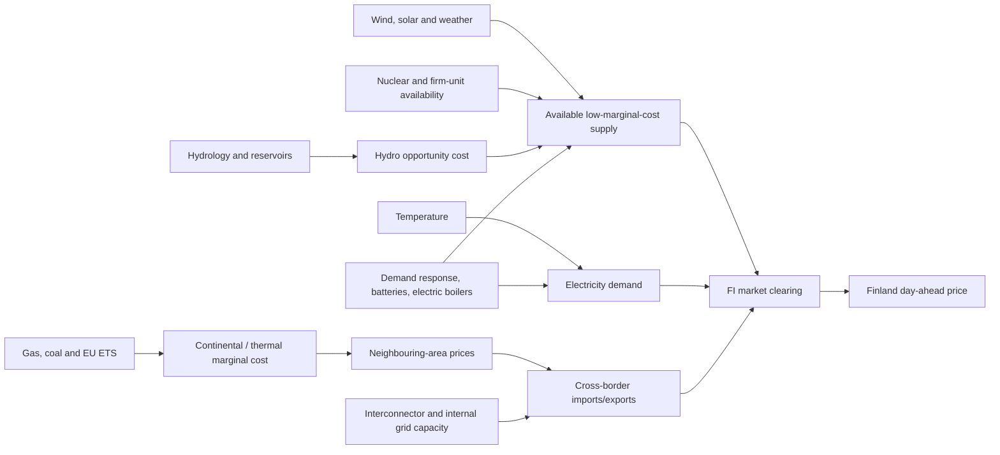

# Factors that determine electricity prices in Finland over the next days to six months

## Executive summary

This report treats the relevant “electricity price” as the **wholesale day-ahead price in the Finnish bidding zone (FI)**, which is the reference price most directly determined by physical supply, demand and cross-border market coupling. Since late 2025, European day-ahead trading has operated on 15-minute market time units, making quarter-hourly forecasts of load, wind, generation availability and transmission capacity increasingly relevant. Retail fixed-price contracts, network tariffs and taxes follow different dynamics and are outside the main scope here. citeturn147065search5turn345194view0

The central finding is that Finnish prices are now governed less by fossil generation costs inside Finland and more by the interaction of **weather-dependent wind generation, temperature-sensitive demand, nuclear availability, cross-border transmission and Nordic hydro conditions**. Finland's 2025 electricity mix illustrates why: nuclear supplied about 37% of electricity, wind 26.1%, hydro 14.5%, while natural gas, coal, oil and peat together accounted for only about 2%; net imports were 6.6%. Wind capacity reached 9.43 GW and generated 22.1 TWh in 2025. citeturn234949view0turn630992search2

For forecasting **a few days to a few weeks ahead**, the most powerful variables are wind forecasts, temperature/load forecasts, nuclear and other large-unit availability, and available cross-border capacity. Finnish Energy explicitly described wind output as the largest individual factor affecting prices in its 2025 market review, while noting demand, heating, plant availability, border connections, fuel/emissions costs and water conditions as the other major drivers. Empirical Nordic research also finds nonlinear effects: a loss of wind tends to raise prices more strongly than an equivalent wind increase lowers them. citeturn676047view0turn439598view1

For **one to six months ahead**, the ranking shifts. Hydrological balance, planned nuclear and transmission outages, seasonal demand, Nordic/continental forward prices, fuel and carbon costs, and changes in generation or large new loads become relatively more important. Nordic hydro is effectively stored energy: reservoir levels, snowpack and expected inflows influence hydro producers' opportunity cost and therefore the supply curve across Sweden and Norway, which then transmits into Finland through interconnectors. Nordic industry reporting for 2024–25 repeatedly linked high reservoir surpluses to lower power prices and subsequent falling reservoir balances to higher prices. citeturn345194view3turn734302search0turn734302search7

Cross-border transmission is unusually important for Finland. The Energy Authority reported that Finland and northern/central Sweden had identical day-ahead prices only about 45% of hours in 2024, while Finland and Estonia were equal only 32% of the time, showing frequent congestion-driven price separation. The EstLink 2 failure and restrictions between Finland and Sweden materially affected Finnish prices in 2024. Conversely, the 700 MW Aurora Line between Finland and northern Sweden, commissioned in November 2025, has increased import capability and reduced price differences and volatility. citeturn345194view0turn345194view4turn740250search0

The scale below is an **analytical synthesis**, not a published official score: **1 = negligible, 2 = weak, 3 = moderate, 4 = strong, 5 = very strong**. A rating of 5 means the factor can plausibly dominate price formation or generate very large price changes under relevant conditions; it does not imply a stable elasticity.

| Factor | Short term: days–weeks | Medium term: weeks–6 months | Key indicators to monitor |
|---|---:|---:|---|
| Wind generation and forecast error | **5 – Very strong** | **4 – Strong** | Fingrid/FMI wind forecast, actual MW, wind capacity factor, Nordic wind forecasts |
| Temperature-driven demand and load | **5 – Very strong** | **4 – Strong** | Temperature forecasts, heating degree days, Fingrid load forecast, peak-demand forecast |
| Nuclear and other firm-generation availability | **5 – Very strong** | **4 – Strong** | OL1–3 and Loviisa availability, REMIT outage notices, planned maintenance |
| Cross-border capacity, flows and neighbouring prices | **5 – Very strong** | **5 – Very strong** | FI–SE1, FI–SE3, FI–EE available capacity; SE1/SE3/EE prices; planned outages |
| Nordic hydrology and hydro opportunity cost | **3 – Moderate** | **5 – Very strong** | Reservoir TWh/%; hydrological balance; precipitation, snowpack and inflow forecasts |
| Internal/Nordic grid congestion and market coupling | **4 – Strong** | **4 – Strong** | Flow-based capacities, congestion income, FI–SE price spreads, grid maintenance |
| Gas, coal and EU ETS carbon prices | **2 – Weak** | **4 – Strong** | TTF gas, EUA, coal; German/Nordic futures; thermal spark/dark spreads |
| Demand response, batteries and flexible electric boilers | **3 – Moderate** | **4 – Strong** | Price-sensitive load, battery capacity, electric-boiler load, balancing volumes |
| Solar generation | **2 – Weak overall** | **2 – Weak overall** | Solar MW forecast, daylight/cloudiness, installed PV; stronger in summer midday |
| Industrial demand and new large loads | **2 – Weak** | **4 – Strong** | Industrial output, data-center commissioning, electric boilers, connection schedules |
| Market-design and balancing changes | **2 – Weak** | **2 – Weak to moderate** | 15-min market operation, balancing prices, reserve costs, flow-based methodology |

The practical implication is that there is no single reliable six-month predictor. Finnish prices emerge from combinations. The most dangerous upside setup is typically **cold weather + weak wind + unavailable nuclear or transmission capacity + a tight Nordic hydro balance**. The strongest downside setup is **mild demand + strong wind + abundant Nordic hydro + unconstrained imports**, increasingly amplified by flexible demand and storage. Fingrid's adequacy studies explicitly model cold, calm conditions together with outages and import capability because these variables interact rather than operate independently. citeturn270580search5turn147065search2

The monthly price history illustrates how large regime changes can be: Nord Pool data show Finnish monthly averages of €117/MWh in January 2026 and €137/MWh in February, falling to about €15/MWh in July; the 2025 annual average was about €40.5/MWh. The chart is descriptive rather than causal—the underlying changes reflect weather, hydrology, generation availability and transmission conditions discussed below. citeturn563247search4turn563247search6turn740250search6

## How Finnish price formation works

Finland participates in the coupled Nordic-European day-ahead market. Producers and consumers submit quantity-price bids, while the market-coupling algorithm clears power across bidding zones subject to available transmission capacity. If transmission were unconstrained, neighbouring areas would tend toward the same price; when a border becomes congested, Finland can separate and acquire its own marginal price. The Nordic system price is calculated as a reference assuming no internal Nordic transmission constraints, whereas the FI area price reflects actual congestion. citeturn345194view0turn563247search1

This distinction is central. A megawatt-hour of cheap Swedish hydro or wind influences Finland only to the extent that the relevant Swedish-Finnish transmission capacity is available. Similarly, expensive continental thermal generation can influence Finland indirectly through chains of interconnected bidding zones, especially when Nordic supply is scarce. Academic work on Nordic markets finds significant cross-border price transmission, with Finland generally acting more as a receiver of shocks than major exporting zones such as Sweden. citeturn499253search20turn499253search31

The causal structure can be summarized as follows:

The structure also explains why correlations can change over time. Finland has become markedly more wind- and nuclear-heavy, cross-border capacity has changed, Russian imports have disappeared, Aurora Line has entered service, flow-based Nordic capacity calculation has replaced the earlier NTC approach, and flexible electric heat and batteries are expanding. A forecasting model estimated on 2018–2021 relationships will therefore systematically misstate some present-day sensitivities. citeturn630992search1turn345194view0turn147065search8

## Factors that dominate the short term

### Wind generation and forecast error — 5/5 short term, 4/5 medium term

**Definition.** This factor is the amount of Finnish and neighbouring Nordic wind generation expected and realized in each delivery interval, including forecast errors between day-ahead scheduling and actual production.

**Mechanism.** Wind has near-zero short-run fuel cost and therefore enters low on the merit order. High wind displaces higher-cost generation and can create excess supply during low-demand periods, pushing prices toward zero or negative levels. Low wind does the opposite: the market must move farther up the supply curve toward hydro with higher opportunity cost, thermal generation or imports. Because Finland now has more than 9 GW of wind capacity, a large weather-driven swing can alter available supply by several gigawatts within a short period. citeturn234949view0turn630992search2

Finnish Energy's December 2025 comparison of daily wind production and spot price shows a conspicuous inverse relationship and states that on windy days electricity is often near zero while low-wind days are more expensive. It identifies wind output as the biggest individual factor affecting Finnish prices. citeturn676047view0

The statistical record supports the structural importance of wind. Wind generation rose from 14.5 TWh in 2023 to roughly 20.2 TWh in 2024 and 22.1 TWh in 2025, while installed capacity reached 9,433 MW. Finland recorded hundreds of negative-price hours as wind and other inflexible generation expanded: 467 hours in 2023 and 725 in 2024 according to the Energy Authority. citeturn234949view0turn345194view0

Academic evidence is consistent with this mechanism. A 2024 *Energy Economics* study using hourly Nordic data found that renewable effects on the merit order are nonlinear and asymmetric: reductions in wind can increase prices by more than equivalent increases in wind reduce them, especially when the market is already tight. A 2025 Finnish-focused modelling study further finds that wind forecast errors create additional balancing demand, largely met by hydro and cross-border exchanges. citeturn439598view1turn114346search1

**Why the medium-term rating falls to 4.** Wind remains important over one to six months, but individual weather forecasts lose skill rapidly. At that horizon, what matters is the probabilistic distribution of wind output, seasonal wind climatology and installed capacity rather than a precise generation forecast. The impact remains structurally large but is less forecastable.

**Monitor:** Fingrid and FMI wind-power forecasts, actual Finnish wind MW, forecast error, Swedish wind output, expected wind capacity factors and upcoming capacity additions. citeturn270580search9turn270580search13

### Temperature, heating demand and total load — 5/5 short term, 4/5 medium term

**Definition.** Electricity demand includes household and service-sector consumption, industry, electric heating, heat pumps and increasingly electric boilers used in district heating. In Finland, temperature is a major exogenous driver of that load.

**Mechanism.** Lower winter temperatures increase electrical heating and heat-pump demand, shifting the demand curve rightward. If the additional load occurs during weak wind or generation outages, the marginal unit can become dramatically more expensive. Fingrid estimates that a 1°C temperature decline can increase Finnish electricity consumption by roughly **150 MW**. citeturn270580search0

The January 2024 cold spell provides an unusually clear natural experiment. Finnish load exceeded 14.5 GW and later approached 15 GW; the prolonged cold coincided with generation disturbances, and the FI hourly day-ahead price reached €1,896/MWh on 5 January. Fingrid specifically identified extreme cold, plant failures and the strained power balance as the main circumstances behind that episode. citeturn270580search1turn270580search4turn740250search0

The same effect appears in aggregate statistics. Electricity consumption increased 10% year-on-year in the first quarter of 2024 during an unusually cold start to the year, and it increased 6.5% in the first half of 2026, when Statistics Finland again identified cold weather as an important cause. citeturn270580search7turn270580search6

Heating degree days are therefore useful at the medium horizon. The Finnish Meteorological Institute defines them specifically as a measure of heating-energy demand, with building heating use approximately related to the indoor-outdoor temperature difference. Seasonal forecasts are much less precise than weather forecasts several days ahead, explaining the lower medium-term score. citeturn270580search8

Demand increasingly responds back to price. Fingrid observed that consumption shifted away from expensive hours during winter 2024–25, and during tight winter situations the TSO expects high prices to activate demand response. Thus the demand curve is no longer completely inelastic. citeturn270580search2turn147065search2

### Nuclear and other firm-generation availability — 5/5 short term, 4/5 medium term

**Definition.** Availability refers to whether large nuclear, CHP and dispatchable plants are online, derated or unavailable because of planned maintenance or unexpected faults.

**Mechanism.** Finnish nuclear units are large relative to system demand. Losing a unit removes a substantial block of low-variable-cost supply at once, moving the market up the merit curve and increasing the need for imports, hydro or more expensive generation.

Olkiluoto 3 alone supplies roughly 14% of Finland's electricity production when operating normally. Its first annual outage in 2024 lasted about 74 days rather than the planned 37 days. Fingrid later listed the delayed OL3 maintenance among the factors affecting Finnish electricity prices in the first half of 2024. citeturn740250search1turn740250search0

The September 2024 price episode provides an even cleaner illustration of interacting outages. Finnish Energy reported that outages at Olkiluoto 2 and Loviisa 1 removed around **1,400 MW** of Finnish nuclear production at the same time that Swedish-Finnish transmission capacity and Swedish nuclear availability were restricted and wind was weak; Finnish spot prices rose sharply. citeturn740250search4

Nuclear availability is highly forecastable when outages are planned, making maintenance calendars especially valuable several months ahead. Unexpected trips, by contrast, are inherently short-term shocks. TVO's 2024 data show the material size of these events: all three Olkiluoto units underwent maintenance, while OL2 also experienced a prolonged generator problem. citeturn740250search5turn740250search10

For a six-month forecast, outage schedules should be treated almost like a seasonal fundamental: a planned 1.6 GW OL3 shutdown during a low-wind period has much greater price significance than the same outage during spring snowmelt and strong imports.

### Cross-border transmission and neighbouring prices — 5/5 at both horizons

**Definition.** Finland is electrically linked to Sweden and Estonia. Cross-border capacity determines how much cheaper foreign supply can reach Finland and how much Finnish surplus generation can be exported.

**Mechanism.** When an interconnector is uncongested, prices tend toward convergence. When it saturates or fails, Finland becomes more dependent on its domestic marginal supply curve. A low Swedish price therefore does not guarantee a low Finnish price: the relevant question is whether enough transmission capacity is available.

In 2024, Finland and SE1 shared the same price only about half of the time, and Finland and Estonia only 32% of the time. EstLink 2, with 658 MW capacity, was unavailable for long periods after its January 2024 failure and again from December 2024. The Energy Authority explicitly attributed cross-zonal price differences to insufficient available transmission capacity. citeturn345194view0

Fingrid similarly stated that Finnish prices in early 2024 were affected by the EstLink 2 failure and by cross-border restrictions. citeturn740250search0

The structural position improved in November 2025 when the Aurora Line added approximately 700 MW between northern Sweden and Finland. Fingrid says the connection has already reduced price differences and volatility; during winter 2025–26, imports from northern Sweden exceeded the former 1,200 MW maximum for 78% of the time, demonstrating that the added capacity was heavily used. citeturn630992search1turn270580search3

This factor remains 5/5 at the medium horizon because planned line maintenance, prolonged cable outages and neighbouring-zone fundamentals are often known weeks or months in advance. They determine whether Finnish prices will track cheap SE1/SE2 conditions, more expensive SE3/Baltic conditions, or become locally isolated.

### Grid congestion and flow-based market coupling — 4/5 at both horizons

This factor is related to interconnectors but broader: internal Nordic network bottlenecks determine the feasible pattern of all cross-border flows simultaneously.

The Nordic region moved to **flow-based day-ahead capacity calculation in October 2024**. ENTSO-E reports that flow-based coupling improved grid utilisation but also changed the distribution of bidding-zone price volatility. The method allocates transmission capacity according to physical network constraints rather than independent bilateral limits, so a change in Swedish or Norwegian network conditions can alter available Finnish import capacity even when the Finnish border itself is technically intact. citeturn345194view0turn563247search10

This deserves a strong rather than very-strong rating because congestion is usually a *transmission channel* for fundamental shocks rather than the original cause. Nevertheless, when a major constraint binds, it can dominate the Finnish price spread.

## Factors that become more important toward six months

### Nordic hydrology and reservoir balance — 3/5 short term, 5/5 medium term

Hydrology is the amount of economically usable water stored in Nordic reservoirs and expected from snow, rainfall and inflows. It is best understood as an inventory of future electricity.

Norway and Sweden contain very large flexible hydro systems. Hydro producers do not bid simply at their negligible physical operating cost: stored water has an **opportunity cost** because using it today means not using it in a potentially more valuable future period. Reservoir levels, snowpack, precipitation and expected inflows therefore affect bidding across weeks and months. citeturn563247search1turn734302search2

The price relationship is well documented. Vattenfall defines the Nordic hydrological balance as stored water, snow and groundwater relative to normal and notes its historically negative relationship with Nordic electricity prices. Fortum reported that high precipitation and the largest reservoir surplus since 2020 put downward pressure on Nordic spot and futures prices in late 2024; during 2025, lower inflows and falling reservoir surpluses subsequently supported prices. citeturn734302search7turn345194view3turn734302search0

At year-end 2025, Nordic reservoirs held around 90 TWh versus an 84 TWh long-term average, down from roughly 99 TWh a year earlier. Such differences are large enough to influence the hydro industry's intertemporal valuation of water for months. citeturn734302search8

Hydrology receives only 3/5 in the very short term because a reservoir imbalance generally moves prices through the value of hydro rather than producing sudden gigawatt-scale shocks like a wind collapse or nuclear trip. Over three to six months, however, it is one of the most important regime variables.

Particularly important indicators are **hydrological balance in TWh relative to normal, reservoir filling percentage, snow-water equivalent, precipitation forecast and expected inflow**. Regional detail matters: northern Swedish/Norwegian hydro conditions are especially relevant to Finland because of the direct SE1 connection.

### Gas, coal and EU ETS prices — 2/5 short term, 4/5 medium term

At first glance, fossil prices should barely matter in Finland because domestic gas and coal generation is now very small. In 2025, gas provided only about 0.9% of electricity and coal about 0.3%. citeturn234949view0

Yet Finland is not electrically isolated. Gas, coal and carbon prices affect thermal marginal costs in Germany, Denmark, the Baltics and other connected markets. Those prices propagate into Nordic bids and cross-border opportunity costs. Academic research published in 2024 finds both direct and indirect transmission of European gas-price shocks into Nordic electricity prices despite low Nordic gas-generation shares. Earlier cross-country research identified Finland among the more vulnerable electricity markets to gas shocks during distressed conditions. citeturn499253search0turn499253search5turn499253search11

ACER's European market monitoring confirms the general mechanism: gas remained important as the flexible marginal technology during tight hours, while renewable variability and gas-supply risk continued to drive price volatility. In the first half of 2025, higher gas and EU ETS prices pushed up wholesale electricity prices across much of Europe, although the Nordics remained cheaper because wind and hydro supply were abundant. citeturn137664search0turn137664search2

For Finland, therefore, fossil inputs are usually a **second-order short-term variable** unless Nordic supply is scarce. Their medium-term importance is larger because gas and EUA futures influence continental forward prices and thus the opportunity value of Nordic exports. They are also more forecastable over several months than wind.

The relevant metrics are Dutch TTF gas, EU ETS EUA, Rotterdam coal, German baseload forwards and Nordic system futures. A sharp rise in TTF is more consequential when reservoirs are low and interconnectors toward higher-priced Europe are unconstrained.

### Demand response, batteries and flexible electric heat — 3/5 short term, 4/5 medium term

Flexible demand reduces the price effect of scarcity and absorbs excess generation during low-price hours.

Finland is increasingly notable for **electric boilers used in district heating**, which can consume electricity when it is cheap and reduce fuel-based heat production. Fingrid reported that electric-boiler projects under construction or operating exceeded 3 GW by August 2026, while storage projects with signed grid-connection agreements exceeded 4 GW. These are large numbers relative to a national peak load around 15–16 GW, although not all contracted projects will be simultaneously commissioned or operated at full capacity. citeturn147065search8turn147065search4

Observed consumer behavior already matters during scarcity. Fingrid stated that significant demand flexibility helped maintain adequacy in the January 2024 cold spell, and its winter 2026–27 assessment explicitly assumes that high prices will activate demand response during the most difficult conditions. citeturn270580search4turn147065search2

The effect is asymmetric. Flexible electric boilers and batteries tend to **raise very low prices** by consuming or charging during surplus periods and **lower extreme high prices** by shutting down or discharging. In other words, they compress the tails of the price distribution rather than simply raising or lowering the average.

The medium-term score is higher because deployment itself is changing quickly. A few hundred megawatts of newly commissioned battery or boiler capacity can materially change the shape of the Finnish residual-demand curve over several months.

### Industrial demand and new large loads — 2/5 short term, 4/5 medium term

Ordinary industrial demand changes relatively slowly compared with weather-driven residential load, so its day-to-day price impact is usually secondary. Over a six-month horizon, however, the commissioning or curtailment of a large industrial facility, data center or heat-electrification project can shift the baseline demand curve.

Finland consumed approximately 85 TWh in 2025, with industry accounting for about 42%. Total consumption rose around 2% from 2024. citeturn234949view0turn147065search5

Fingrid's 2026 outlook says growth is accelerating, led particularly by data centers and electric boilers. By mid-August 2026, data-center projects with signed connection agreements represented almost 5 GW of intended final capacity, although Fingrid stresses that these projects ramp gradually and many will take years to reach full load. citeturn147065search4turn147065search8

For a six-month forecast, therefore, one should track **actual commissioning dates**, not headline connection enquiries. A 1 GW load announced for 2030 is irrelevant to next winter; a 200 MW data-center phase entering operation next month is not.

### Solar generation — 2/5 at both horizons

Solar output follows irradiance, cloud cover and daylight. Like wind, its marginal cost is near zero, so it pushes midday prices down when production is strong.

Its current national impact is still much smaller than wind. Solar produced only around 1.2% of Finnish electricity in 2025, versus 26.1% for wind. citeturn234949view0

That aggregate statistic understates solar's effect during bright summer midday hours, when demand can be modest and wind/hydro supply abundant. Nevertheless, Finnish solar does not yet have the system-wide price-setting influence seen in countries such as Germany, Spain or the Netherlands. Its impact is therefore weak overall but locally important in the lower tail of summer daytime prices.

Cloud forecasts, daylight hours and installed PV capacity are the relevant indicators.

### Market design, balancing rules and 15-minute trading — 2/5 short term, 2/5 medium term

Market rules rarely create energy scarcity by themselves, but they determine how efficiently scarcity or surplus is priced and transferred between time periods and zones.

Europe completed the transition of the day-ahead market to 15-minute periods in autumn 2025. Fingrid argues that shorter settlement and trading periods allow faster responses to weather-dependent changes in production and demand and improve price formation. Nordic balancing-market integration also expanded through common aFRR and mFRR platforms. citeturn147065search5turn563247search10

These reforms can change intraday volatility, balancing costs and the ability of batteries and flexible loads to react. They matter more for the *shape and efficiency* of short-term prices than for the several-month average level, which remains dominated by physical fundamentals.

## Interactions and nonlinear price regimes

Finnish electricity prices are highly nonlinear. The same 1 GW wind reduction has a modest effect when demand is low, reservoirs are full and imports are unconstrained, but it can have a huge effect during a cold winter evening when nuclear availability is reduced and interconnectors are already saturated. This is consistent with the Nordic empirical finding that declining wind can have a stronger price effect than increasing wind. citeturn439598view1

January 2024 illustrates the scarcity regime. Exceptionally cold weather raised demand toward 15 GW while thermal-generation disturbances reduced available supply; the highest Finnish hourly day-ahead price reached €1,896/MWh. Fingrid subsequently described that period as the winter's most challenging adequacy episode. citeturn270580search4turn740250search0

By contrast, 2024 also produced 725 negative-price hours—up from 467 in 2023—reflecting the opposite regime of abundant low-marginal-cost generation relative to demand and flexibility. Finland had one of Europe's highest frequencies of negative electricity prices that year. citeturn345194view0turn137664search3

The winter 2025–26 experience shows how transmission investment can alter the regime. A new national demand record of 15,553 MW was reached on 8 January 2026 at a system-weighted temperature around −19°C, but the FI day-ahead price for the peak quarter-hour was about €92/MWh rather than the extreme values seen in January 2024. Domestic production was 14,320 MW and net imports 1,233 MW; Aurora Line materially strengthened the import position. This does not prove that Aurora Line alone caused the lower price—the generation and wind situation was different—but it demonstrates how additional import capability reduces scarcity risk. citeturn270580search3

For forecasting, it is therefore more useful to think in **joint states** than isolated variables:

| Market state | Typical price implication |
|---|---|
| Cold + calm + nuclear outage + constrained imports | Extreme upside risk |
| Cold + windy + high nuclear availability | Moderate/high demand but much lower scarcity risk |
| Mild + windy + high reservoirs | Very low or negative prices possible |
| Low wind + dry Nordic hydrology + high gas/EUA | Persistently elevated price regime |
| High wind + constrained exports from Finland | Strong downside/negative-price risk |
| Large flexible-boiler/battery demand + high renewable output | Low-price tail partly absorbed |
| Swedish surplus + unconstrained Aurora Line | Downward pull on FI price |
| Swedish/Baltic price rise + unconstrained links | Upward transmission into FI |

These are qualitative state descriptions rather than deterministic rules; the market-clearing outcome depends on simultaneous bidding curves and network constraints. citeturn563247search1turn345194view0

## What to monitor for an actionable forecast

For the **next two to ten days**, the information hierarchy should start with weather and operational data. The highest-value inputs are Finnish and Swedish wind forecasts, temperature/load forecasts, REMIT notices for nuclear and large generators, day-ahead interconnector availability and neighbouring-area prices. Fingrid's own load forecasting explicitly combines real-time system measurements with temperature history and weather forecasts. citeturn270580search13

For roughly **two to six weeks**, add planned maintenance calendars, Nordic precipitation and hydrological-balance forecasts, extended temperature/wind ensemble distributions and scheduled grid outages. At this horizon, a single deterministic weather forecast should be replaced by scenario probabilities.

For **one to six months**, the core dashboard should shift toward reservoir and snow balances, planned nuclear outages, planned interconnector/grid outages, TTF/EUA and Nordic/German forward prices, expected generation additions, and confirmed new consumption. Market forward prices themselves are useful not because they are infallible forecasts, but because they aggregate participants' expectations of these fundamentals and their risk premia.

Nord Pool provides historical and current day-ahead prices, flows, capacities, consumption, production and hydro-reservoir data; Fingrid provides Finnish real-time load, generation and forecasts; Statistics Finland and Finnish Energy provide slower but authoritative structural data; ENTSO-E provides cross-border and generation data across Europe. Those sources should form the primary data layer before adding commercial weather or commodity analytics. citeturn563247search0turn563247search8turn270580search12turn147065search0

One important limitation is that there is **no stable single-factor elasticity** such as “1 GW less wind raises the Finnish price by €X/MWh.” The merit-order slope changes hour by hour, transmission constraints change which generators can reach Finland, hydro bids reflect water value, and demand is becoming more price-responsive. For several factors—especially demand response, batteries and new industrial loads—the market is changing so quickly that long historical regressions may understate their future relevance. citeturn137664search5turn147065search8

The most defensible forecasting approach is consequently probabilistic: model **residual demand = load − wind − solar − inflexible generation**, then overlay hydro conditions, import capability and neighbouring marginal costs. Extreme Finnish prices occur when several adverse residual-demand and network variables align, not when one indicator crosses a fixed threshold. citeturn114346search2turn270580search5

## Overall assessment

Finland has moved from a market in which imported power and thermal costs played a relatively direct role toward a system dominated by **nuclear plus variable renewable generation, connected to a hydro-rich Nordic market and increasingly reliant on flexible demand and interconnection**. In 2025, nuclear, wind and hydro together accounted for roughly four-fifths of Finnish electricity supply, while fossil-fired generation had become marginal in volume. citeturn234949view0

That transformation makes **weather and availability risk** the defining short-term price drivers. Wind can move several gigawatts; temperature can move demand by roughly 150 MW per degree; a single nuclear outage can remove around a gigawatt or more; and a constrained interconnector can prevent cheap Nordic electricity from reaching Finland. Those shocks explain why Finnish prices can move from near zero to hundreds of euros per MWh over very short periods. citeturn270580search0turn740250search4turn676047view0

At the six-month horizon, weather still matters but becomes inherently uncertain. The more forecastable variables—hydrological balance, reservoir and snow conditions, planned outages, transmission maintenance, fuel/carbon forwards, capacity additions and large new loads—therefore deserve greater weight. Hydrology in particular becomes much more important because it determines the opportunity cost of the Nordic system's principal dispatchable renewable resource. citeturn734302search7turn734302search8

The highest-confidence hierarchy is therefore: **wind, load, firm-generation availability and interconnectors for days ahead; hydrology, planned availability, cross-border conditions and regional forward fundamentals for months ahead**. Fuel and carbon costs remain relevant primarily through external price transmission rather than domestic Finnish thermal generation. Flexible demand and storage are the fastest-growing moderating forces and are likely to become progressively more important in both tails of the Finnish price distribution. citeturn499253search5turn147065search8